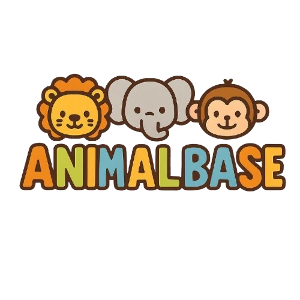

<div align="center">



# Animal Base

**A friendly, educational guide to the animal kingdom.**


</div>

Animal Base is a multi-page educational website that introduces children (and curious adults) to seven animal families through facts, photos, search and a small quiz. It is **front-end only**: no backend, no database, no frameworks and no paid services.

> **Version 2.0** is a complete rebuild of a first-year university project. See [Project history](#project-history) for the full story.

---

## Table of contents

- [Overview](#overview)
- [Team](#team)
- [Features](#features)
- [Pages](#pages)
- [Tech stack](#tech-stack)
- [Tools used](#tools-used)
- [Project structure](#project-structure)
- [Run locally](#run-locally)
- [Editing content](#editing-content)
- [Design system](#design-system)
- [Accessibility](#accessibility)
- [Images and licensing](#images-and-licensing)
- [Project history](#project-history)
- [Known limitations](#known-limitations)

---

## Overview

| | |
|---|---|
| **Purpose** | Teach children about animals in a simple, safe and fun way |
| **Audience** | Kids, parents and teachers |
| **Content** | 7 animal families, 38 animals, a fish quiz, a photo gallery |
| **Type** | Static multi-page website (HTML, CSS, JavaScript) |
| **Pages** | 13 |
| **Dependencies** | None at runtime (Google Fonts is optional, with system-font fallbacks) |

## Team

Created by first-year students at the Faculty of Computers and Artificial Intelligence.

| # | Name | Role | Contribution |
|:-:|---|---|---|
| 1 | **Shaher Mamdouh Ahmed** | **Team Leader** | Led the team and contributed to the layout |
| 2 | Malak Samir Tolba | Team Member | Worked on the navigation |
| 3 | Tarek Hany Mohamed | Team Member | Helped with the styling |
| 4 | Aalaa Tarek Ibrahim | Team Member | Developed the animal pages |
| 5 | Mazen Mohamed Ahmed | Team Member | Assisted with the design |
| 6 | Sabrin Walid Moustafa | Team Member | Managed the images |
| 7 | Hamdy Waleed Abdullah | Team Member | Wrote the introduction text |
| 8 | Seifeldin Tamer Kamal | Team Member | Organized the content |

---

## Features

**Learning**
- 38 animals with habitat, diet, a fun fact and a link to read more. Every card opens an accessible details dialog.
- Category pages with an introduction, key traits and a topic-specific section (for example, *Arachnid or insect?* comparison table, *Three ways to be a mammal*, *Fish at a glance*).
- **Fish or not a fish?**: a nine-question quiz with instant explanations and a final score.
- Animal of the day, rotating fun facts and a photo gallery with a lightbox.

**Search and navigation**
- Live search by name, habitat or diet, combined with family filters, a result counter and an empty state.
- Responsive header with an *Animals* menu, a category pill bar on every family page, and previous/next links.

**Personalisation (stored only in your browser)**
- Three themes: **Light**, **Dark** and **Playful**, plus *follow my device*.
- Reduce-motion option, a display name shown in the home greeting, and a personal animal list.

**Honest forms**
- Login and register are clearly labelled **demos**: they validate input, send nothing and never store passwords.
- The contact form validates input, then opens the visitor's email app with a ready-made message (`mailto:`).

**Quality**
- Mobile-first, fully responsive layouts (tested down to 375 px with no horizontal scrolling).
- Semantic HTML, keyboard-friendly menus and dialogs, WCAG-checked colour contrast, `prefers-reduced-motion` support.
- SEO basics: titles, descriptions, canonical URLs, Open Graph tags, `sitemap.xml`, `robots.txt`.

## Pages

| Page | Description |
|---|---|
| `index.html` | Landing page with a full-screen hero and the seven families |
| `home.html` | Browse by family, search and filter all animals, animal of the day, fun facts, gallery |
| `mammals.html` · `birds.html` · `insects.html` · `arachnids.html` · `mollusks.html` · `reptiles.html` | One page per animal family |
| `fish.html` | Fish facts, sea life that is not a fish, and the quiz |
| `about.html` | Project description and team |
| `contact.html` | Validated contact form and social links |
| `login.html` | Demo login and registration with tabs |
| `settings.html` | Theme, motion, display name and personal animal list |

## Tech stack

| Layer | Technology |
|---|---|
| Structure | **HTML5** with semantic landmarks, `<dialog>`, `<details>`, ARIA roles and live regions |
| Styling | **CSS3**: custom properties (design tokens and themes), Grid, Flexbox, `clamp()` fluid type, `color-mix()`, `aspect-ratio`, media queries |
| Behaviour | **Vanilla JavaScript** (classic scripts, no modules, so it runs from `file://`), `localStorage` for preferences |
| Icons | Inline **SVG** sprite (no icon font) |
| Images | Optimised **WebP**, lazy loading, `fetchpriority` on hero images |
| Typography | **Bricolage Grotesque** (headings) and **Figtree** (body) via Google Fonts, with system fallbacks |
| Page generation | **Python 3 standard library only** (`src/build.py`) |
| Content | **JSON** (`src/content.json`) |

## Tools used

| Tool | Used for |
|---|---|
| **Visual Studio Code** (or any editor) | Writing and editing code |
| **Git and GitHub** | Version control and hosting the repository |
| **Python 3** | Running the page generator |
| **Playwright + Chromium (headless)** | Automated testing: JavaScript errors, broken images and links, horizontal overflow, and interaction tests (search, dialogs, themes, settings, quiz, forms, mobile menu) |
| **Pillow, FFmpeg, ImageMagick** | Converting and optimising images during the rebuild |
| **Browser DevTools** | Responsive and accessibility checks |
| **Claude (Anthropic)** | AI assistance for the version 2.0 redesign, refactor and testing |

## Project structure

```
Animal-Site/
├── index.html … settings.html     13 generated pages
├── assets/
│   ├── css/
│   │   ├── base.css               tokens, themes, reset, typography
│   │   ├── components.css         header, buttons, cards, dialog, forms, footer
│   │   └── pages.css              page-specific layouts
│   ├── js/
│   │   ├── theme-init.js          applies the saved theme before first paint
│   │   ├── site.js                menus, theme toggle, greeting
│   │   ├── catalog.js             details dialog, search and filter, lightbox
│   │   ├── home.js                animal of the day, rotating facts
│   │   ├── quiz.js                fish quiz
│   │   ├── forms.js               login, register and contact validation
│   │   ├── settings.js            theme, motion, name, personal list
│   │   └── data.js                generated from content.json
│   └── img/                       brand/, hero/, cat/, animals/ (WebP)
├── src/
│   ├── content.json               all categories and animals
│   └── build.py                   page generator
├── sitemap.xml
└── robots.txt
```

## Run locally

No installation is needed.

1. Download or clone the project.
2. Open `index.html` in any modern browser.

Or use a small local server:

```bash
python3 -m http.server 8000
# open http://localhost:8000
```

## Editing content

The header, footer and animal cards are generated from one template, so nothing is copy-pasted between pages. To add or change an animal, edit `src/content.json`, then rebuild:

```bash
python3 src/build.py
```

Requirements: Python 3.8 or newer (standard library only). You can also edit the generated HTML and CSS directly.

An animal entry looks like this:

```json
{
  "id": "lion",
  "cat": "mammals",
  "name": "Lion",
  "sci": "Panthera leo",
  "img": "lion",
  "alt": "A lion lying on a rock",
  "summary": "...",
  "habitat": "...",
  "diet": "...",
  "fun": "...",
  "wiki": "Lion",
  "credit": "Optional photographer credit"
}
```

## Design system

- **Palette:** deep forest green and sun yellow (from the logo), with one accent colour per animal family (rust for mammals, blue for birds, teal for fish, honey for insects, plum for arachnids, rose for mollusks, moss for reptiles).
- **Themes:** all colours are CSS custom properties, so Light, Dark and Playful are token overrides on `<html data-theme="...">`.
- **Layout:** fluid type and spacing with `clamp()`, a 72 rem container, and card grids that reflow with `auto-fill`.
- **Motion:** one entrance animation on the landing page and subtle hover feedback. Everything respects reduced-motion settings.

## Accessibility

- Skip link, landmarks and a single `h1` per page.
- Keyboard support for the menus, dialogs (focus returns to the trigger), and the login tabs (arrow keys).
- `aria-live` regions for search results, quiz feedback and form status; `aria-invalid` and `aria-describedby` on form errors.
- Colour pairs checked against WCAG AA contrast.

## Images and licensing

The original project did not record where its images came from, so their licences are **unknown**, and several look AI-generated. Before publishing widely, replace them with photos whose licence you can verify (for example from [Unsplash](https://unsplash.com/), after reading its licence terms).

1. Save a matching photo as WebP (about 1200 px wide, 4:3 works best) to `assets/img/animals/<id>.webp`.
2. Optionally add a `"credit"` field to that animal in `content.json`. It appears in the details dialog.
3. Run `python3 src/build.py`.

## Project history

### Version 1.0: first-year university project

Animal Base started as a team assignment during the **first year** at the **Faculty of Computers and Artificial Intelligence**, and it was **submitted to the faculty** at that time. It was one of the team's first attempts at front-end development.

- Built with plain HTML, CSS and JavaScript, with a separate page for each animal family.
- Included a landing page, a home page, animal pages, an about page, a contact page, a login page and a settings page.
- Used background video, an ambient audio clip, Font Awesome from a CDN, and some externally hosted images.
- Typical beginner-project issues: duplicated code and styles, inconsistent layouts, a few broken or missing script references, outdated visual design, and some mislabelled content.

### Version 2.0: complete modernisation (current)

Version 2.0 keeps the original idea and identity but rebuilds almost everything:

- **Architecture:** shared CSS design system, modular JavaScript, and a small Python generator so pages share one template and one content file.
- **Design:** a new nature-inspired visual identity, three themes, and a responsive mobile-first layout.
- **Features:** live search and filtering, animal details dialogs, animal of the day, a gallery with lightbox, the fish quiz, and a reptiles page (the original project had the images but no page).
- **Quality:** accessibility, SEO metadata and automated browser testing.
- **Content fixes:** corrected scientific names and mislabelled animals (for example, a bat that was listed among the birds).
- **Honesty:** login, register and contact are clearly front-end demos.
- **Lighter by design:** video and audio were removed, icons are inline SVG, images are optimised WebP and no runtime dependencies remain.

### Version summary

| | v1.0 | v2.0 |
|---|---|---|
| Stage | First year, submitted to the faculty | Portfolio-ready rebuild |
| Pages | 12 | 13 (adds Reptiles) |
| Design | Basic student layout | Modern design system with 3 themes |
| Code | Duplicated, page-specific files | Shared CSS and JS, generated pages |
| Search and filter | Limited | Live search plus family filters |
| Media | Video and audio | Optimised WebP images only |
| Testing | Manual | Automated browser tests |

## Known limitations

- Several original photos are small (about 270 px wide) and look soft on large or high-density screens.
- The four fish cards use emoji because the original project had no matching fish photos.
- Login and register are demonstrations by design; there is no backend.
- The contact form depends on the visitor's email app.
- Animal facts were rewritten for clarity and checked for common errors, but have not been reviewed by a biologist.

---

Version 2.0 modernisation: November 2026.
